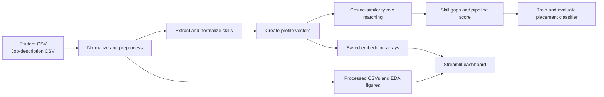

# NLP-Driven Regional Employability Mapping

A Streamlit application and Python data pipeline for exploring engineering-student skills, job-role alignment, skill gaps, placement outcomes, and regional patterns in Warangal.

## Project at a glance

Students and colleges need a clearer way to compare student-reported capabilities with the skills expected for different job roles. This project turns student-profile and job-description CSV files into processed profiles, skill comparisons, role similarities, analytical scores, and regional summaries.

The project is an exploratory decision-support tool. Its scores are estimates based on the fields present in the dataset; they are not guarantees of employment and should not be used as the sole basis for decisions about students.

### Current data snapshot

The public repository includes a small **synthetic demo dataset** for trying the dashboard. It does not contain real student records, locally generated embeddings, or classifier artifacts. Its demo metrics are illustrative only and must not be interpreted as findings about a real student population.

The Home and Regional Dashboard estimates use the dashboard formula documented below. They are distinct from the fuller weighted score produced by the offline pipeline.

## Problem statement

- Student profiles describe skills and experience in varied formats, making role readiness difficult to compare consistently.
- Job descriptions list required and optional skills, but the gap between a student's profile and a selected role is not always easy to see.
- College-level summaries can help users explore regional patterns, but should not be mistaken for campus-level or causal analysis.

## Objectives

1. Normalize student and job-description data for consistent analysis.
2. Extract and standardize skills from profile text, projects, and internship details.
3. Compare each student profile with job roles and present the strongest similarities.
4. Identify missing skills and calculate role-skill coverage.
5. Summarize placement, readiness, branch, and college patterns in an interactive dashboard.
6. Train and evaluate a placement-status classifier as an offline pipeline output.
7. Make the analysis transparent about its inputs, estimates, and limitations.

## What the application contains

The Streamlit app is launched from `app/app.py`. It uses Streamlit's page navigation and shared components and theme code in `app/components.py`, `app/theme.py`, and `app/styles.css`.

| Page | What it provides |
| --- | --- |
| **Home** | Dataset KPIs, the current dashboard estimate and placement rate, and links to the student and regional views. |
| **Student View** | Select a saved student profile; inspect the dashboard estimate, readiness band, top three role similarities, profile details, and role-specific skill gaps. Users can filter displayed skills and preview extra skills; preview text does not change saved scores or matches. |
| **Regional Dashboard** | Filter by college, branch, and year; review summary KPIs, a Warangal regional-centroid map, a college comparison chart, and a college summary table. The map uses OpenStreetMap tiles and does not need an API key. |
| **Insights** | Explore common skills and gaps, student target-role preferences, the job-role catalogue, and branch comparisons. The Clusters tab is currently an empty state because clustering results are not part of the current processed dataset. |
| **About** | Project purpose, workflow, technology list, dataset transparency, limitations, and FAQs. |

### Important distinction between scores and predictions

The app currently shows a lightweight **dashboard estimate**, not a prediction from the saved classifier:

```text
dashboard estimate =
    50% × normalized CGPA
  + 35% × target-role skill coverage
  + 15% × placed-status indicator
```

The result is capped to the 0–100 range. Readiness bands are:

| Score | Band |
| --- | --- |
| Below 40 | Needs Improvement |
| 40 to below 60 | Developing |
| 60 to below 80 | Job Ready |
| 80 to 100 | Highly Employable |

The offline pipeline also computes a separate **weighted employability score** using the configured role-match, academic, experience, activity, communication, and backlog inputs. The app's current pages do not load `models/placement_model.joblib` to make student-level placement predictions. The model artifact and its cross-validation metrics are generated by the pipeline.

## Data and input files

The app reads processed CSV files. In the public deployment, it uses the synthetic examples in `data/demo/processed/`. Local files in `data/processed/` take precedence when present, and private deployments can set `EMPLOYABILITY_PROCESSED_DATA_DIR` to an approved directory. Raw data, generated models, and reports are excluded from Git by default.

### Student dataset

The private input file `data/raw/student_employability_dataset.csv` should follow this student-profile schema:

```text
student_id, name, college, college_locality, home_locality, branch, year,
cgpa, skills_listed, skills_text, project, has_internship, internship_detail,
target_role, pref_location, lagging, want_to_learn, self_readiness,
num_projects, num_certifications, hackathons_participated, active_github,
backlogs, communication_rating, placement_status, is_placed, is_cs_branch,
n_skills, n_required, role_coverage, skills_str, gap_str
```

Fields cover student identity and education, self-reported skills and experience, target roles and locations, placement status, and derived skill/readiness values. The CSV includes names and student IDs; do not publish raw or processed individual-level records in a presentation or public repository.

### Job-role dataset

The private input file `data/raw/job_descriptions.csv` should follow this job-role schema:

```text
job_id, role, domain, job_description, required_skills,
good_to_have_skills, experience_level
```

### Data provenance

The public demo records are synthetic. Before using a private dataset, confirm its source, collection date, permissions, and any required anonymization. Do not commit individual-level records or locally generated model artifacts.

## Processing and analytical methods

The main workflow is implemented in `src/pipeline.py`.

1. **Preprocessing** (`src/preprocessing.py`)
   - Loads the two raw CSV files and normalizes column names.
   - Cleans text fields and converts selected numeric fields to numeric values.
   - Derives indicators such as internship status, active GitHub, placement status, and CS-branch status.
   - Writes `students_processed.csv` and `jobs_processed.csv`.
   - Prints a data-quality summary and saves four exploratory charts.

2. **Skill extraction** (`src/skill_extraction.py`)
   - Builds a skill vocabulary from required and good-to-have job skills.
   - Normalizes skill tokens and expands aliases (for example, `ml` to `machine learning` and `nlp` to `natural language processing`).
   - Collects skills from profile fields, project text, internship details, and related text.
   - Uses KeyBERT keyphrases when available; the module has a simple keyword-frequency fallback for unavailable or failed keyphrase extraction.

3. **Profile embeddings and role matching** (`src/embeddings.py`, `src/matching.py`)
   - Builds text profiles from student skills, profile text, projects, internship details, and target roles; job profiles include role descriptions and skill lists.
   - Uses `all-MiniLM-L6-v2` through Sentence Transformers when it can be loaded. Otherwise, it falls back to TF-IDF vectors.
   - Compares profiles with cosine similarity and saves student and job vectors as NumPy files.
   - Records each student's top three similar roles and similarity scores.

4. **Skill gaps and pipeline score** (`src/scoring.py`)
   - Compares a student's extracted skills with the required skills for the student's target role.
   - Computes role coverage as the fraction of required skills found in the profile.
   - Stores missing skills and produces recommendations for up to five gaps.
   - Computes a configured 0–100 weighted score and assigns a readiness band.

5. **Placement classifier** (`src/model.py`)
   - Trains on records whose year contains “final year”, using `is_placed` as the target.
   - The default pipeline uses class-balanced Logistic Regression with numeric imputation and one-hot encoding for college and branch.
   - The model helper also supports Random Forest and XGBoost choices.
   - Evaluates predictions using stratified five-fold cross-validation and reports accuracy, precision, recall, F1, ROC AUC, and a confusion matrix.
   - Saves the fitted pipeline to `models/placement_model.joblib`. The metrics are printed by the pipeline; no evaluation-report file is currently generated automatically.

### Pipeline score inputs

The offline weighted score is configured in `config.yaml`:

| Input | Weight |
| --- | ---: |
| Role / skill match | 35% |
| CGPA | 20% |
| Internship | 15% |
| Projects | 10% |
| Certifications | 8% |
| Hackathons | 5% |
| GitHub activity | 4% |
| Communication | 3% |
| Backlog penalty | Separate subtraction: 1 point per backlog, up to 5 points with the current configuration |

The role-match component blends target-role embedding similarity and required-skill coverage at 50% each. Project, certification, hackathon, and communication values are normalized against configured caps in `src/scoring.py`; the final score is clipped to 0–100. The backlog penalty is subtracted separately.

## Architecture



The dashboard also contains descriptive views built directly from the processed CSVs. The Regional Dashboard displays a fixed Warangal regional centroid because campus-level coordinates are not present in the current dataset; its circle represents the size of the active filtered selection, not individual campus locations.

## Current results and outputs

The public demo uses synthetic records. The pipeline generates exploratory figures, embeddings, and a classifier from whichever input data is supplied locally; these outputs are ignored by Git because they may encode information about private records. No model evaluation metrics are stated here because the project does not store a fixed evaluation report.

## Project structure

```text
employability-mapping/
├── app/
│   ├── app.py                       # Streamlit entry point and navigation
│   ├── components.py                # Shared cards, page headers, badges, timeline
│   ├── theme.py                     # Shared CSS and Plotly chart theme
│   ├── styles.css                   # Responsive visual and accessibility styles
│   └── pages/
│       ├── 0_Home.py
│       ├── 1_Student_View.py
│       ├── 2_Regional_Dashboard.py
│       ├── 3_Insights.py
│       └── 4_About.py
├── data/
│   ├── demo/processed/              # Synthetic sample data for the public app
│   ├── raw/                         # Private input files (not committed)
│   ├── processed/                   # Local pipeline outputs (not committed)
│   └── geo/                         # Optional geocoding cache location
├── models/                          # Local generated embeddings/classifier (not committed)
├── reports/
│   ├── figures/                     # Generated EDA charts
│   └── maps/                        # Reserved for map outputs
├── src/
│   ├── config.py                    # Project paths and configuration loader
│   ├── preprocessing.py             # CSV cleanup, derived fields, EDA
│   ├── skill_extraction.py          # Skill taxonomy and extraction
│   ├── embeddings.py                # Sentence Transformer / TF-IDF vectors
│   ├── matching.py                  # Student-to-role similarity matching
│   ├── scoring.py                   # Skill gaps, coverage, weighted score
│   ├── model.py                     # Placement classifier and metrics
│   ├── evaluation.py                # Matching and manual-review helpers
│   ├── clustering.py                # Student clustering helpers
│   ├── geo.py                       # Geocoding helpers and regional overrides
│   ├── dashboard_ui.py              # Standalone dashboard theme helpers
│   └── pipeline.py                  # End-to-end data/model pipeline
├── tests/
│   └── test_core.py                 # Focused core logic tests
├── .streamlit/config.toml           # Streamlit color and typography defaults
├── config.yaml                      # App title, score weights, model settings
├── requirements.txt                 # Pinned Python dependencies
├── Makefile                         # Convenience commands
└── README.md
```

`evaluation.py`, `clustering.py`, and `geo.py` provide helper functionality but are not run as steps of the current `src.pipeline` workflow. The app's Clusters tab is therefore a placeholder until cluster outputs are produced and connected.

## Technology stack

| Technology | Use in this project |
| --- | --- |
| Python | Data processing, NLP helpers, scoring, and model training |
| Streamlit | Multi-page interactive application |
| pandas and NumPy | CSV processing, tabular analysis, and saved vectors |
| Sentence Transformers and KeyBERT | Semantic profile embeddings and keyword extraction when available |
| scikit-learn | TF-IDF fallback, similarity utilities, preprocessing, classification, and evaluation |
| XGBoost | Optional classifier supported by the model helper |
| Plotly and Folium | Interactive charts and regional map |
| Matplotlib | Generated exploratory figures |
| Joblib | Persistence of the fitted classifier |
| PyYAML | Loading `config.yaml` |

Exact dependency versions are listed in `requirements.txt`. Some NLP models may need to be downloaded the first time the pipeline runs; a network connection may be required for that initial model setup.

## Setup and run

Run commands from the `employability-mapping` project directory.

### Windows PowerShell

```powershell
py -m venv .venv
.\.venv\Scripts\Activate.ps1
python -m pip install --upgrade pip
python -m pip install -r requirements.txt
```

### macOS or Linux

```bash
python -m venv .venv
source .venv/bin/activate
python -m pip install --upgrade pip
python -m pip install -r requirements.txt
```

### Run the data pipeline

Place approved private input files at the paths shown in [Data and input files](#data-and-input-files), then run:

```bash
python -m src.pipeline
```

The pipeline preprocesses the files, extracts skills, generates role matches and scores, saves embeddings and the classifier, and prints its data-quality and evaluation summaries.

### Run the dashboard

Run the pipeline first if the processed CSVs or model/embedding artifacts need to be created or refreshed. Then launch the app:

```bash
python -m streamlit run app/app.py
```

The application opens in a browser. The public version runs from synthetic demo data; the Regional Dashboard uses OpenStreetMap tiles and requires no map API key.

### Deploy with Streamlit Community Cloud

1. Push this repository to GitHub.
2. In Streamlit Community Cloud, create an app from the repository's `main` branch.
3. Set the app file to `app/app.py` and deploy.

The public app uses only synthetic demo records. Do not upload student records, model files, or generated reports to the public repository. Private processed data can be supplied to a separately secured deployment through `EMPLOYABILITY_PROCESSED_DATA_DIR`.

### Run tests

The repository's test suite uses pytest. If pytest is not installed in the active environment:

```bash
python -m pip install pytest
python -m pytest -q
```

The current tests cover skill-token normalization, gap and coverage calculations, score bounds and readiness bands, and job-skill taxonomy construction.

## Configuration

`config.yaml` contains:

- `project_name` and `app_title`.
- `data_description`, which should be updated with verified dataset provenance.
- The weighted pipeline-score inputs and backlog penalty.
- The random seed.
- Matching settings, including the embedding model name and top-k setting.
- Creator metadata.

Project paths are defined in `src/config.py` relative to the project root. The Streamlit theme defaults are in `.streamlit/config.toml`; the main application theme and chart palette are defined in `app/theme.py` and `app/styles.css`.

## Limitations and responsible use

- Scores depend on self-reported and available profile data; missing or inconsistent fields affect comparisons.
- The dashboard estimate, offline weighted score, and placement classifier are separate outputs. Do not describe the dashboard estimate as a classifier prediction.
- The classifier is trained from historical placement labels. Cross-validation results should be reviewed before discussing predictive performance.
- The current regional map shows a regional centroid, not campus locations or student-level geography.
- The current Clusters tab has no generated cluster results.
- Skill extraction and similarity matching depend on the supplied job catalogue and NLP model availability.
- Dataset source, collection methodology, permissions, and ownership are not fully documented in the current configuration.
- Student names and IDs are present in the CSV schema. Protect individual-level data; use aggregated, privacy-reviewed results in slides.
- This tool supports exploration and discussion. It does not guarantee placement and should not be the sole basis for high-impact decisions.

## Suggested presentation outline

The following sequence mirrors the supplied project-presentation style and can be adapted into slides:

1. **Title** — project name, team members, and institution/course details if verified.
2. **Problem statement** — why student-role alignment and skill gaps need clearer visibility.
3. **Objectives** — the project goals listed above.
4. **Data sources** — the two CSV files, their schemas, current record counts, and verified provenance.
5. **System architecture** — the pipeline diagram in this README.
6. **Methodology: preprocessing and skills** — column normalization, taxonomy, aliases, and keyphrase extraction.
7. **Methodology: role matching and gaps** — embeddings, cosine similarity, top-three roles, coverage, and gaps.
8. **Scoring and placement model** — explain the separate dashboard estimate, weighted pipeline score, and classifier.
9. **Implementation** — technology stack, project structure, and generated artifacts.
10. **Dashboard and results** — screenshots of the five pages and aggregated current dataset summaries.
11. **Limitations and future work** — data provenance, privacy, campus coordinates, cluster integration, and model validation.
12. **Conclusion** — summarize the tool as a transparent, regional employability-exploration dashboard.

Before presenting results, rerun the pipeline on the intended dataset, verify all data-source and permission details, and use only aggregate statistics that are appropriate to share.
